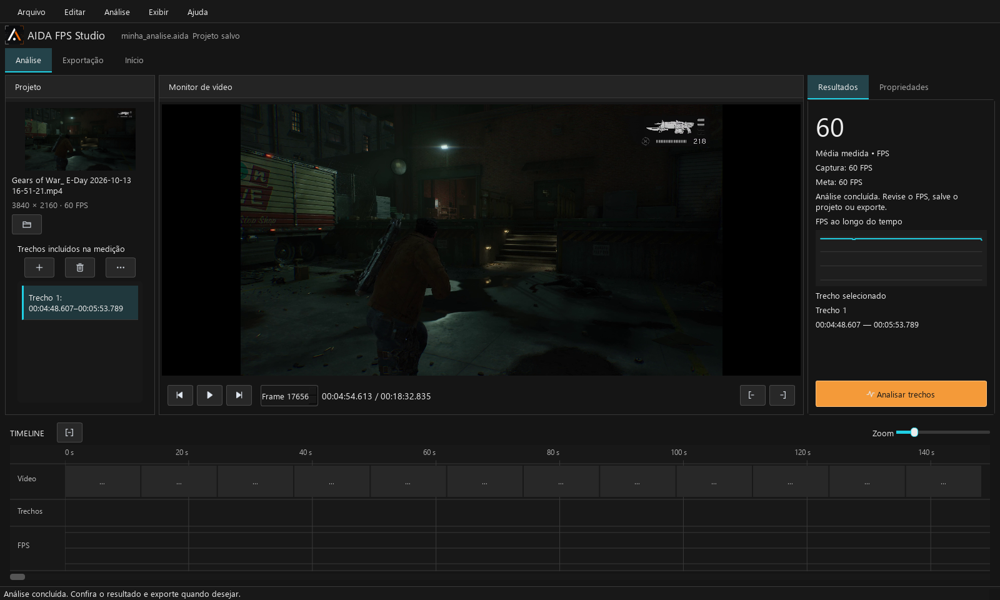

# AIDA FPS Studio 0.8.15

[](https://github.com/Gotikozzy/aida-fps-studio/actions/workflows/ci.yml)
[Português](README.pt-BR.md) · [User guide](docs/en/USER_GUIDE.md) · [Methodology](docs/en/METHODOLOGY.md) · [Build](docs/en/BUILD.md)

AIDA FPS Studio is a native Windows application for analyzing **observable video cadence
and FPS** from local recordings. It combines frame navigation, temporal selections,
motion evidence, a continuous FPS chart, reusable `.aida` projects and annotated exports.
Processing runs locally with a CPU backend or optional NVIDIA optical-flow acceleration.
The interface and exported presentation support English and Portuguese.



## Capabilities

| Area | Behavior |
|---|---|
| Media | Decode local video with PyAV; index frame timestamps (PTS and time base); navigate individual frames. |
| Timeline | Create, name, resize and review analysis intervals with thumbnails and an FPS chart. |
| Analysis | Compare frames and motion evidence to estimate observable content cadence; retain uncertainty and read gaps. |
| Projects | Save selections, configuration and analysis reports in a versioned `.aida` file. |
| Presentation | Inspect an export preview and select a presentation reference within the capture's supported rate. |
| Delivery | Export a silent 1080p H.264 MP4, a structured JSON report, or both. |
| Execution | CPU operation; optional NVIDIA optical flow; background jobs, progress and cancellation. |

## What the FPS result means

The input is a **recording**, not game-engine telemetry. Capture FPS describes the
recorded frame sequence; observable content cadence describes visible updates within
that sequence. A 120 Hz recording can contain content updating at 40 FPS. The recording
alone cannot establish whether a frame was rendered, interpolated or repeated by the
capture chain.

The analyzer combines visual-change decisions with measured timing. Compression,
static scenes, motion limited to an overlay, scene cuts and unreadable frames can reduce
coverage or make an interval inconclusive. Repeated images do not identify their cause.
An inconclusive interval is not zero FPS. Dotted chart sections indicate limited evidence
or a presentation projection; they must be read alongside warnings and coverage.
Changing the display reference does not create new measurements.

Results retain source/frame references, PTS/time base, ROI information, parameters,
backend and analyzer versions. Read the [methodology](docs/en/METHODOLOGY.md) before
using the results in a technical comparison.

## Windows requirements and installation

- Windows 10 or 11, x64.
- The packaged application includes Python and its runtime dependencies.
- CPU analysis works without an NVIDIA GPU. NVIDIA acceleration requires compatible
  optical-flow hardware and an installed driver; end users do not need CUDA Toolkit.
- Keep the original video accessible and provide disk space for cache, projects and exports.
  Processing time and storage use depend on recording resolution, duration and codec.

Obtain published packages from the [official site](https://detonandogueek.com.br/aida)
or the [repository releases](https://github.com/Gotikozzy/aida-fps-studio/releases).
The installer is named `AIDA-FPS-Studio-<version>-windows-x64-setup.exe`; its `setup.zip`
archive contains that installer. Extract it before running. Installation targets the
current account, adds a Start menu entry and supports `.aida` file association; the
desktop shortcut and offline update-check mode are optional components.

**Project executables and installers are distributed without Authenticode signing.**
Windows may display an unknown-publisher or reputation warning. Check the download origin,
version and published SHA-256 before deciding to run it. Do not disable Windows security
protections. SHA-256 verifies bytes against a reference; it does not authenticate the
publisher. See the [distribution policy](CODE_SIGNING.md).

```powershell
Get-FileHash -Algorithm SHA256 -LiteralPath .\AIDA-FPS-Studio-0.8.15-windows-x64-setup.exe
```

Compare the entire digest with the entry for that exact file in the release's
`SHA256SUMS.txt`. A ZIP and its EXE have different digests. A development portable ZIP,
when provided, requires `AIDA-FPS-Studio.exe` and its `_internal` directory to stay together.
It is a different package from the updater's installer ZIP.

## First analysis

1. Choose **New analysis** and open a local recording, or use **Open project** for `.aida`.
2. Inspect the first frame and progressive thumbnails. Wait for the precise timestamp
   index before marking intervals, analyzing or exporting.
3. Select representative intervals. Record capture rate, recording conditions and any
   recompression; include enough scene motion to support the comparison.
4. Run the analysis. Inspect the measured summary, chart, warnings and visual evidence.
   Review low-confidence intervals before attributing a drop to the game.
5. Save the `.aida` project. Keep the original video with it: media and regenerable caches
   are external to the project.
6. In **Export**, select destination, content, language and encoding. Refresh the preview,
   export, then inspect the resulting MP4/JSON.

The JSON delivery is called an **LLM report** in the interface. It contains measurements,
coverage and interpretation guidance; the application does not call an LLM or generate
narration. MP4 exports have no audio. See the [user guide](docs/en/USER_GUIDE.md) for
navigation, project recovery, cache maintenance and troubleshooting.

## Local data and updates

Decoding, analysis and export run locally. Videos, frames, projects and results are not
uploaded. Startup checks request the [official update manifest](https://detonandogueek.com.br/aida/update.json);
download and installer launch require confirmation. Disable automatic checks with the
installer's offline component or an empty `.disable-update-check` beside the executable
(repository root for source execution). Delete the marker to enable checks again.

The updater checks package size, SHA-256, archive contents and executable structure;
it does not validate Authenticode. See [updates](docs/en/UPDATES.md) and [privacy](PRIVACY.md).
Local diagnostics can contain file paths; review them before attaching them to an issue.

## Development and verification

Source execution requires Python 3.12 on Windows x64. The reference build uses Python
3.12.7 and the hash-pinned dependency lock. From the repository root:

```powershell
py -3.12 -m venv .venv
.\.venv\Scripts\python.exe -m pip install --require-hashes -r requirements-windows.lock
.\.venv\Scripts\python.exe -m pip install --no-deps --no-build-isolation -e .
.\.venv\Scripts\python.exe scripts/check_repository.py
.\.venv\Scripts\python.exe scripts/verify_source_integrity.py
.\.venv\Scripts\python.exe -m pytest -q
.\.venv\Scripts\python.exe -m dg_fps
```

The Qt Widgets UI delegates work to controllers/jobs. Media indexing and cadence analysis
stay outside the UI; GPU work uses a serialized queue. The Python package is `dg_fps`.
No web server, account, model download or LLM is required for measurement.

Development wheels are distinct from the release media runtime. Follow the
[Windows build guide](docs/en/BUILD.md) to build the reference FFmpeg runtime, optional
native bridge, frozen application and NSIS installer. Build from a committed checkout:
source archives use Git `HEAD`. Generated artifacts remain outside Git.

## Technical documentation

| Topic | Reference |
|---|---|
| Operation and limitations | [User guide](docs/en/USER_GUIDE.md), [methodology](docs/en/METHODOLOGY.md) |
| Design and scope | [Architecture](docs/en/ARCHITECTURE.md), [normative specification](SPECIFICATION.md) |
| Build and distribution | [Build](docs/en/BUILD.md), [release procedure](docs/en/RELEASE.md), [distribution policy](CODE_SIGNING.md) |
| Evidence | [Validation procedure](docs/en/VALIDATION.md), [recorded GitHub build](docs/GITHUB_BUILD_VALIDATION.md), [SBOM](docs/RELEASE_SBOM.md) |
| Maintenance | [Contributing](CONTRIBUTING.md), [security reporting](SECURITY.md), [changelog](CHANGELOG.md) |
| Learning | [Teaching guide](docs/en/TEACHING.md) |

Recorded validation applies to the commit and artifact hashes listed in each report.
A new build requires its own verification; a source checkout is not a published installer.

## License

Application code is licensed under [Apache-2.0](LICENSE). Dependencies retain their own
licenses and notices: [third-party notices](THIRD_PARTY_NOTICES.md),
[licensing scope](docs/en/LICENSING.md), [asset inventory](docs/ASSETS.md).
Videos and projects remain user content. Historical 0.8.14 documents describe their
original packages; the current source license is defined by this repository's license files.
