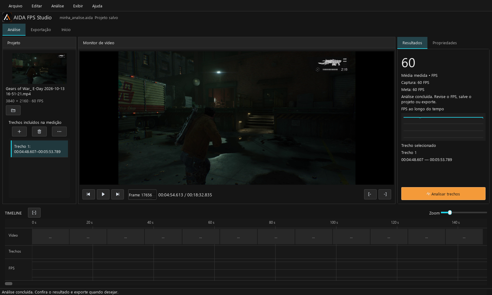

# AIDA FPS Studio 0.8.15

[](https://github.com/Gotikozzy/aida-fps-studio/actions/workflows/ci.yml)
[English](README.md) · [Manual](docs/pt-BR/USER_GUIDE.md) · [Metodologia](docs/pt-BR/METHODOLOGY.md) · [Build](docs/pt-BR/BUILD.md)

O AIDA FPS Studio é um aplicativo nativo Windows para analisar **cadência visual e FPS
observáveis** em gravações locais. Reúne navegação por quadros, seleção de trechos,
evidências de movimento, gráfico contínuo de FPS, projetos `.aida` e exportações anotadas.
O processamento é local, por CPU ou com aceleração opcional de fluxo óptico NVIDIA.
A interface e a apresentação exportada oferecem português e inglês.



## Recursos

| Área | Funcionamento |
|---|---|
| Mídia | Decodifica vídeos locais com PyAV, indexa timestamps dos quadros (PTS e time base) e permite navegação quadro a quadro. |
| Timeline | Cria, nomeia, ajusta e revisa trechos de análise com miniaturas e curva de FPS. |
| Análise | Compara quadros e evidências de movimento para estimar cadência observável; preserva incertezas e lacunas de leitura. |
| Projetos | Salva seleções, configurações e relatórios em arquivo `.aida` versionado. |
| Apresentação | Permite conferir a prévia e escolher uma referência de apresentação compatível com a taxa da captura. |
| Entrega | Exporta MP4 H.264 1080p sem áudio, relatório JSON estruturado ou ambos. |
| Execução | Funciona por CPU; oferece fluxo óptico NVIDIA opcional, tarefas em segundo plano, progresso e cancelamento. |

## O que o resultado de FPS significa

A entrada é uma **gravação**, não telemetria da engine. O FPS da captura descreve a
sequência registrada; a cadência observável descreve as atualizações visíveis nessa
sequência. Uma captura de 120 Hz pode conter conteúdo atualizado a 40 FPS. O vídeo
isolado não demonstra se um quadro foi renderizado, interpolado ou repetido pela cadeia
de captura.

O analisador combina decisões de mudança visual com tempos medidos. Compressão,
cenas estáticas, movimento restrito a um overlay, cortes e quadros ilegíveis podem
reduzir a cobertura ou tornar um intervalo inconclusivo. Imagens repetidas não identificam
a causa da repetição. Um intervalo inconclusivo não equivale a zero FPS. Partes
pontilhadas do gráfico indicam evidência limitada ou projeção de apresentação; devem ser
lidas junto dos avisos e da cobertura. Alterar a referência exibida não cria medições.

Os resultados preservam referências à origem e aos quadros, PTS/time base, informações
de ROI, parâmetros, backend e versões dos analisadores. Consulte a
[metodologia](docs/pt-BR/METHODOLOGY.md) antes de usar resultados em comparações técnicas.

## Requisitos e instalação no Windows

- Windows 10 ou 11, x64.
- O aplicativo empacotado inclui Python e suas dependências de execução.
- A análise por CPU funciona sem GPU NVIDIA. A aceleração exige hardware compatível
  com fluxo óptico e driver instalado; o usuário não precisa instalar CUDA Toolkit.
- Mantenha o vídeo original acessível e espaço para cache, projetos e exportações.
  Tempo de processamento e armazenamento dependem da resolução, duração e codec.

Obtenha pacotes publicados no [site oficial](https://detonandogueek.com.br/aida)
ou nas [releases do repositório](https://github.com/Gotikozzy/aida-fps-studio/releases).
O instalador se chama `AIDA-FPS-Studio-<versão>-windows-x64-setup.exe`; o arquivo
`setup.zip` contém esse instalador. Extraia antes de executar. A instalação é feita para
a conta atual, cria entrada no menu Iniciar e oferece associação a `.aida`; atalho na
área de trabalho e modo offline de consulta de atualizações são componentes opcionais.

**Os executáveis e instaladores do projeto são distribuídos sem assinatura Authenticode.**
O Windows pode exibir aviso de editor desconhecido ou de reputação. Confira origem,
versão e SHA-256 publicado antes de decidir executar. Não desative as proteções de
segurança do Windows. SHA-256 confere bytes contra uma referência; não autentica o
editor. Consulte a [política de distribuição](CODE_SIGNING.md).

```powershell
Get-FileHash -Algorithm SHA256 -LiteralPath .\AIDA-FPS-Studio-0.8.15-windows-x64-setup.exe
```

Compare o resumo completo com a entrada desse arquivo no `SHA256SUMS.txt` da release.
O ZIP e o EXE têm hashes diferentes. O ZIP portátil de desenvolvimento, quando fornecido,
exige que `AIDA-FPS-Studio.exe` e `_internal` permaneçam juntos. Esse pacote é diferente
do ZIP de instalador usado pelo atualizador.

## Primeira análise

1. Escolha **Nova análise** para abrir uma gravação local ou **Abrir projeto** para `.aida`.
2. Examine o primeiro quadro e as miniaturas progressivas. Aguarde o índice temporal
   preciso antes de marcar trechos, analisar ou exportar.
3. Selecione intervalos representativos. Registre taxa e condições da captura e eventual
   recompressão; inclua movimento de cena suficiente para sustentar a comparação.
4. Execute a análise. Confira resumo medido, gráfico, avisos e evidências visuais.
   Revise intervalos de baixa confiança antes de atribuir uma queda ao jogo.
5. Salve o projeto `.aida`. Preserve o vídeo original: mídia e caches regeneráveis
   ficam fora do arquivo de projeto.
6. Em **Exportação**, escolha destino, conteúdo, idioma e codificação. Atualize a prévia,
   exporte e confira o MP4/JSON gerado.

A interface chama a entrega JSON de **relatório LLM**. O arquivo contém medições,
cobertura e orientações de interpretação; o aplicativo não consulta uma LLM nem gera
narração. Os MP4s não têm áudio. O [manual](docs/pt-BR/USER_GUIDE.md) detalha navegação,
recuperação de projetos, manutenção do cache e resolução de problemas.

## Dados locais e atualizações

Decodificação, análise e exportação são locais. Vídeos, quadros, projetos e resultados
não são enviados. Na abertura, o aplicativo consulta o
[manifesto oficial](https://detonandogueek.com.br/aida/update.json); baixar e executar o
instalador exige confirmação. Desative a consulta automática com o componente offline
do instalador ou um arquivo vazio `.disable-update-check` ao lado do executável
(raiz do repositório na execução por fontes). Apague o marcador para reativar.

O atualizador verifica tamanho, SHA-256, conteúdo do ZIP e estrutura do executável;
não valida Authenticode. Consulte [atualizações](docs/pt-BR/UPDATES.md) e
[privacidade](PRIVACY.md). Diagnósticos locais podem conter caminhos; revise antes de
anexar a uma issue.

## Desenvolvimento e verificação

A execução por fontes exige Python 3.12 em Windows x64. O build de referência usa
Python 3.12.7 e dependências fixadas com hashes. Na raiz do repositório:

```powershell
py -3.12 -m venv .venv
.\.venv\Scripts\python.exe -m pip install --require-hashes -r requirements-windows.lock
.\.venv\Scripts\python.exe -m pip install --no-deps --no-build-isolation -e .
.\.venv\Scripts\python.exe scripts/check_repository.py
.\.venv\Scripts\python.exe scripts/verify_source_integrity.py
.\.venv\Scripts\python.exe -m pytest -q
.\.venv\Scripts\python.exe -m dg_fps
```

A interface Qt Widgets delega tarefas a controladores/jobs. Indexação de mídia e análise
de cadência ficam fora da UI; o trabalho GPU usa fila serializada. O pacote Python se
chama `dg_fps`. A medição não exige servidor web, conta, download de modelos ou LLM.

Os wheels de desenvolvimento diferem do runtime de mídia da release. Siga o
[guia de build Windows](docs/pt-BR/BUILD.md) para compilar o FFmpeg de referência,
a ponte nativa opcional, o aplicativo congelado e o instalador NSIS. Use checkout commitado:
os arquivos de fontes são gerados de Git `HEAD`. Artefatos gerados ficam fora do Git.

## Documentação técnica

| Tema | Referência |
|---|---|
| Operação e limites | [Manual](docs/pt-BR/USER_GUIDE.md), [metodologia](docs/pt-BR/METHODOLOGY.md) |
| Projeto e escopo | [Arquitetura](docs/pt-BR/ARCHITECTURE.md), [especificação normativa](SPECIFICATION.md) |
| Build e distribuição | [Build](docs/pt-BR/BUILD.md), [procedimento de release](docs/pt-BR/RELEASE.md), [política de distribuição](CODE_SIGNING.md) |
| Evidências | [Procedimento de validação](docs/pt-BR/VALIDATION.md), [build GitHub registrado](docs/GITHUB_BUILD_VALIDATION.md), [SBOM](docs/RELEASE_SBOM.md) |
| Manutenção | [Contribuição](CONTRIBUTING.md), [relato de segurança](SECURITY.md), [histórico](CHANGELOG.md) |
| Aprendizado | [Guia para o curso](docs/pt-BR/TEACHING.md) |

Cada registro de validação se aplica ao commit e aos hashes nele indicados. Um novo
build exige verificação própria; um checkout de fontes não é um instalador publicado.

## Licença

Código do aplicativo sob [Apache-2.0](LICENSE). Dependências mantêm suas próprias
licenças e avisos: [terceiros](THIRD_PARTY_NOTICES.md),
[escopo de licenciamento](docs/pt-BR/LICENSING.md), [inventário de imagens](docs/ASSETS.md).
Vídeos e projetos continuam sendo conteúdo do usuário. Documentos históricos 0.8.14
descrevem seus pacotes originais; a licença atual é definida pelos arquivos deste repositório.
